<!-- SELECTED PUBLICATIONS, shown one at a time in the middle of the home page.

     Each paper is one block, newest first, that starts with the line ::: {.paper} and ends with a
     line of three colons. To add a paper, copy a block and change its text. To remove one, delete
     its block. The order here is the order of the arrows.

     Inside a block:
       first line     year and journal, plus [New]{.paper-new} if you want the "New" label
       ### line       the title
       next line      the authors, with your name in **bold**
       paragraph      a short summary (or paste your abstract instead)
       figure         from the line ```{=html} to the next ``` : the picture in images/papers/,
                      a description of it for readers who cannot see it (alt="..."), and the
                      caption under it, which ends with the credit (the paper it comes from,
                      and the copyright or licence notice where the publisher asks for one)
       tags line      the topic labels
       last line      the link buttons

     On wide screens every card is as tall as the photo-and-contact column; the picture takes the
     space the text leaves free, so pictures wider than tall fit best.

     The summaries were written in my own words from each paper's abstract. Replace any of them
     with your own abstract if you prefer. -->

::: {.paper}
[2026 · *Nonlinearity* **39**, 115006 · open access]{.paper-meta} [New]{.paper-new}

### Second quantization for classical nonlinear dynamics

[D. Giannakis, M. J. Latifi Jebelli, M. Montgomery, P. Pfeffer, J. Schumacher and **J. Slawinska**]{.paper-authors}

Borrowing tools from many-body quantum theory, we represent the evolution of observables of
ergodic, measure-preserving flows as rotations on tori. Weighted Fock spaces built from reproducing
kernel Hilbert spaces form commutative Banach algebras whose spectra split into tori. Approximate
Koopman operators lift to rotations on these tori, so observables evolve as Fourier polynomials built
from products of approximate Koopman eigenfunctions. The scheme is data-driven, is demonstrated on
the Stepanoff flow and the Lorenz 63 system, and connects naturally to quantum computing.

```{=html}
<figure class="paper-figure">
  <div class="paper-figure-img"></div>
  <figcaption>Figure 4 · Eigenfunctions of the regularized generator for the Stepanoff flow <span class="paper-credit">From Giannakis et al., arXiv:2501.07419.</span></figcaption>
</figure>
```

[arXiv:2501.07419](https://arxiv.org/abs/2501.07419){.btn .btn-outline-primary .btn-sm}
[doi:10.1088/1361-6544/aea8b9](https://doi.org/10.1088/1361-6544/aea8b9){.btn .btn-outline-primary .btn-sm}
:::

::: {.paper}
[2026 · *SIAM Journal on Applied Dynamical Systems* · in press]{.paper-meta}

### Learning dynamical systems with the spectral exterior calculus

[S. Das, D. Giannakis, Y. Gu and **J. Slawinska**]{.paper-authors}

A data-driven method for learning dynamical systems on compact Riemannian manifolds with the
spectral exterior calculus. Vector fields are reconstructed from data in a way that respects the
nonlinear geometry of the manifold, so the flows they generate consistently approximate the true
system. We prove convergence in the limit of large data and illustrate the method numerically.

```{=html}
<figure class="paper-figure">
  <div class="paper-figure-img">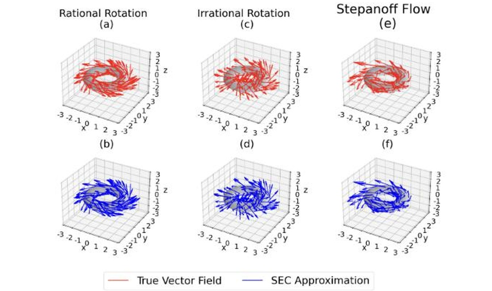</div>
  <figcaption>Figure 7 · True and SEC-approximated vector fields on the 2-torus <span class="paper-credit">From Das et al., arXiv:2505.06061.</span></figcaption>
</figure>
```

[arXiv:2505.06061](https://arxiv.org/abs/2505.06061){.btn .btn-outline-primary .btn-sm}
:::

::: {.paper}
[2026 · *Journal of Climate* **39**, 3905–3930]{.paper-meta}

### A Koopman interpretation of the recharge oscillator model for ENSO

[T. Carr, D. Giannakis, B. R. Lintner, **J. Slawinska** and C. C. Ummenhofer]{.paper-authors}

El Niños tend to be stronger and shorter than La Niñas, and the main causes of this asymmetry are
still debated. The recharge oscillator, the standard conceptual model of ENSO, couples two equations
for equatorial sea surface temperature and thermocline depth; it explains how events grow, decay and
change phase, but it is ambiguous about asymmetry. We sidestep part of that question by treating temperature and
thermocline depth as observables of a dynamical system, rather than as its state, and modeling their
evolution with the Koopman operator. ENSO is still a single eigenmode, as in the recharge oscillator,
but a learned nonlinear function of the observables, so it can evolve asymmetrically. The model
emulates the observed evolution and needs no assumption about which physical processes matter most.
A simple model built on this eigenmode reproduces leading features of the asymmetry in the CESM2
preindustrial simulation: El Niños decay faster in spring, multiyear La Niñas are more common, and
La Niña anomalies sit further west. The framework may help explain why climate models disagree about
how ENSO will change in the future.

```{=html}
<figure class="paper-figure">
  <div class="paper-figure-img"></div>
  <figcaption>Figure 5 · Nonlinear embedding reduces deterministic forecast bias <span class="paper-credit">From Carr et al., <em>J. Climate</em> 39, 3905&ndash;3930. &copy; 2026 American Meteorological Society.</span></figcaption>
</figure>
```

[doi:10.1175/JCLI-D-25-0527.1](https://doi.org/10.1175/JCLI-D-25-0527.1){.btn .btn-outline-primary .btn-sm}
:::

::: {.paper}
[2026 · *Journal of Computational Physics* **562**, 114992]{.paper-meta}

### Quantum mechanical closure of partial differential equations with symmetries

[C. Vales, D. C. Freeman, **J. Slawinska** and D. Giannakis]{.paper-authors}

A framework for closing PDE models whose small scales are not resolved. The classical dynamics is
embedded in a quantum mechanical system: quantum states represent the unresolved degrees of freedom
statistically, and quantum measurement predicts their effect on the resolved scales. A
positivity-preserving discretization gives a compressed model that respects the symmetries of the
dynamics. For the shallow water equations it reproduces the main features of the true dynamics,
including from initial conditions it was not trained on.

```{=html}
<figure class="paper-figure">
  <div class="paper-figure-img">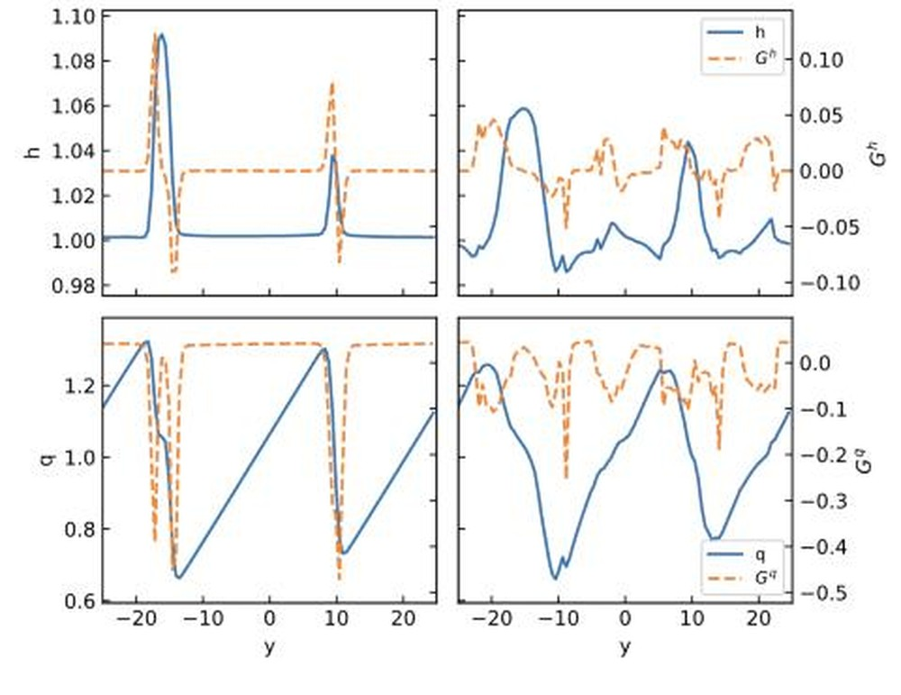</div>
  <figcaption>Figure 4 · True and predicted spatial profiles of the resolved state and subgrid fluxes <span class="paper-credit">From Vales et al., arXiv:2505.07519.</span></figcaption>
</figure>
```

[doi:10.1016/j.jcp.2026.114992](https://doi.org/10.1016/j.jcp.2026.114992){.btn .btn-outline-primary .btn-sm}
[arXiv:2505.07519](https://arxiv.org/abs/2505.07519){.btn .btn-outline-primary .btn-sm}
:::

::: {.paper .paper-fill}
[2025 · preprint, in revision]{.paper-meta}

### Tensor network approximation of Koopman operators

[D. Giannakis, M. J. Latifi Jebelli, M. Montgomery, P. Pfeffer, J. Schumacher and **J. Slawinska**]{.paper-authors}

A tensor network scheme for the evolution of observables of ergodic systems. A regularized Koopman
generator is lifted to a Fock space, where the evolution is computed by a positivity-preserving tree
tensor network drawing on a space of dimension (2*d* + 1)^*n*^ from 2*d* + 1 eigenfunctions. With
classical observables and densities as quantum observables and states, it shares the mathematics of
many-body quantum physics and opens a route to quantum computers; the open step is recasting its
non-unitary comultiplication operators as quantum gates.

```{=html}
<figure class="paper-figure">
  <div class="paper-figure-img"></div>
  <figcaption>Figure 4 · Tree tensor network used to compute the Fock space evolution <span class="paper-credit">From Giannakis et al., arXiv:2407.07242.</span></figcaption>
</figure>
```

[arXiv:2407.07242](https://arxiv.org/abs/2407.07242){.btn .btn-outline-primary .btn-sm}
:::

::: {.paper}
[2024 · *Nature Communications* **15**, 4268]{.paper-meta}

### Revealing trends and persistent cycles of non-autonomous systems with autonomous operator-theoretic techniques

[G. Froyland, D. Giannakis, E. Luna and **J. Slawinska**]{.paper-authors}

Forced systems such as the climate are usually studied with ensembles of experiments. We show that
eigenfunctions of Koopman and transfer operators, built for autonomous systems, can identify
nonlinear trends and persistent cycles of forced systems from a single trajectory. Applications
include sea surface temperature over the industrial era and the mid-Pleistocene transition of
glaciation cycles, where the 40,000-year cycle is recovered from benthic δ¹⁸O records.

```{=html}
<figure class="paper-figure">
  <div class="paper-figure-img"></div>
  <figcaption>Figure 1 · Models of frequency switching (Model F) and co-existing frequencies (Model F′) <span class="paper-credit">From Froyland et al., arXiv:2308.04045.</span></figcaption>
</figure>
```

[doi:10.1038/s41467-024-48033-6](https://doi.org/10.1038/s41467-024-48033-6){.btn .btn-outline-primary .btn-sm}
[arXiv:2308.04045](https://arxiv.org/abs/2308.04045){.btn .btn-outline-primary .btn-sm}
:::

::: {.paper}
[2024 · *Multiscale Modeling & Simulation* **22**, 283–333]{.paper-meta}

### Quantum mechanics for closure of dynamical systems

[D. Freeman, D. Giannakis and **J. Slawinska**]{.paper-authors}

A data-driven way to parameterize the unresolved part of a dynamical system with quantum mechanics
and Koopman operator theory. A surrogate system carries a quantum state, a density operator that
evolves under the Koopman operator and supplies the fluxes from the unresolved variables at each
step. New values of the resolved variables update it through a quantum Bayes rule. Kernel methods
turn states, observables and evolution operators into matrices, so the schemes preserve positivity
automatically.

```{=html}
<figure class="paper-figure">
  <div class="paper-figure-img"></div>
  <figcaption>Figure 2 · Lorenz 63 trajectories: true dynamics (a) and the quantum mechanical closure (b) <span class="paper-credit">From Freeman et al., <em>Multiscale Model. Simul.</em> 22, 283. © 2024 Society for Industrial and Applied Mathematics.</span></figcaption>
</figure>
```

[doi:10.1137/22M1514246](https://doi.org/10.1137/22M1514246){.btn .btn-outline-primary .btn-sm}
[arXiv:2208.03390](https://arxiv.org/abs/2208.03390){.btn .btn-outline-primary .btn-sm}
:::

::: {.paper}
[2024 · preprint]{.paper-meta}

### Koopman spectral analysis of skew-product dynamics on Hilbert C\*-modules

[D. Giannakis, Y. Hashimoto, M. Ikeda, I. Ishikawa and **J. Slawinska**]{.paper-authors}

We introduce a linear operator on a Hilbert C\*-module, defined by composition and multiplication,
for analysing skew-product dynamical systems. It admits an eigenoperator decomposition that
generalizes the eigenvalue decomposition and reconstructs the Koopman operator, representing its
continuous spectrum through eigenoperators. The construction is related to cocycles and Oseledets
subspaces, and helps characterize coherent structures under skew-product dynamics.

```{=html}
<figure class="paper-figure">
  <div class="paper-figure-img">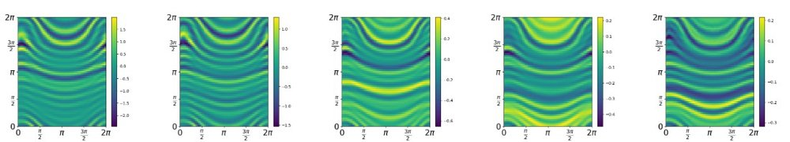</div>
  <figcaption>Figure 2 · Real part of an eigenoperator of the skew-product system <span class="paper-credit">From Giannakis et al., arXiv:2307.08965.</span></figcaption>
</figure>
```

[arXiv:2307.08965](https://arxiv.org/abs/2307.08965){.btn .btn-outline-primary .btn-sm}
:::

::: {.paper}
[2023 · *Geophysical Research Letters* **50**, e2023GL102743]{.paper-meta}

### Identification of the Madden–Julian Oscillation with data-driven Koopman spectral analysis

[B. R. Lintner, D. Giannakis, M. Pike and **J. Slawinska**]{.paper-authors}

The Madden–Julian Oscillation is the main source of tropical variability over weeks to months, and
is usually tracked with indices built from empirical orthogonal functions. We extract it instead with
data-driven Koopman spectral analysis of daily outgoing longwave radiation and zonal winds, giving
an operator-theoretic picture of the oscillation to set beside the conventional indices.

```{=html}
<figure class="paper-figure">
  <div class="paper-figure-img">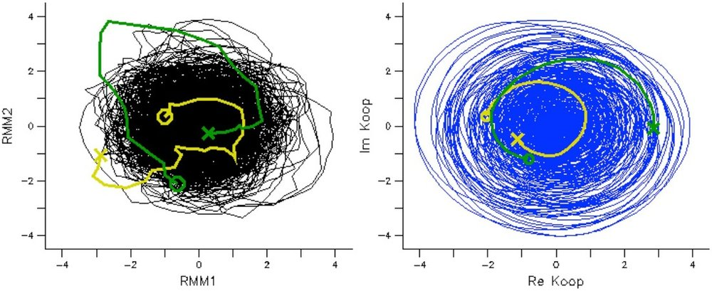</div>
  <figcaption>Figure 1 · MJO phase space from the RMM index (left) and from Koopman eigenfunctions (right) <span class="paper-credit">From Lintner et al., <em>Geophys. Res. Lett.</em> 50, e2023GL102743.</span></figcaption>
</figure>
```

[doi:10.1029/2023GL102743](https://doi.org/10.1029/2023GL102743){.btn .btn-outline-primary .btn-sm}
:::

::: {.paper}
[2023 · *The Cryosphere* **17**, 3883–3893 · open access]{.paper-meta}

### Phase-field models of floe fracture in sea ice

[H. Dinh, D. Giannakis, **J. Slawinska** and G. Stadler]{.paper-authors}

A phase-field model of brittle fracture for kilometre-sized sea ice floes, which balances the energy
of elastic deformation against the energy it costs to crack. Floes with random thickness variations,
standing for refrozen cracks and other impurities, are loaded at their edges to study their
strength. The orientation of the thickness variations turns out to control both the strength of a
floe and the direction of its cracks. Applications to discrete element simulations and to field data
from the ICEX 2018 campaign are discussed.

```{=html}
<figure class="paper-figure">
  <div class="paper-figure-img"></div>
  <figcaption>Figure 3 · Random ice-thickness fields (top) and the fractures they produce (bottom) <span class="paper-credit">From Dinh et al., <em>The Cryosphere</em> 17, 3883.</span></figcaption>
</figure>
```

[doi:10.5194/tc-17-3883-2023](https://doi.org/10.5194/tc-17-3883-2023){.btn .btn-outline-primary .btn-sm}
:::

::: {.paper}
[2023 · *Proceedings of the National Academy of Sciences* **120**, e2211115120]{.paper-meta}

### Data assimilation in operator algebras

[D. Freeman, D. Giannakis, B. Mintz, A. Ourmazd and **J. Slawinska**]{.paper-authors}

An algebraic framework for sequential data assimilation. Bayesian filtering is embedded in a
non-abelian operator algebra, where observables become multiplication operators and probability
densities become quantum states. The forecast step is a quantum operation induced by the Koopman
operator, and the analysis step is a quantum effect that generalizes Bayes' rule. The
finite-dimensional versions preserve positivity, can be learned from data with kernel methods, and
suit quantum computers; they show promising skill for the Lorenz 96 multiscale system and for ENSO
in a climate model.

```{=html}
<figure class="paper-figure">
  <div class="paper-figure-img">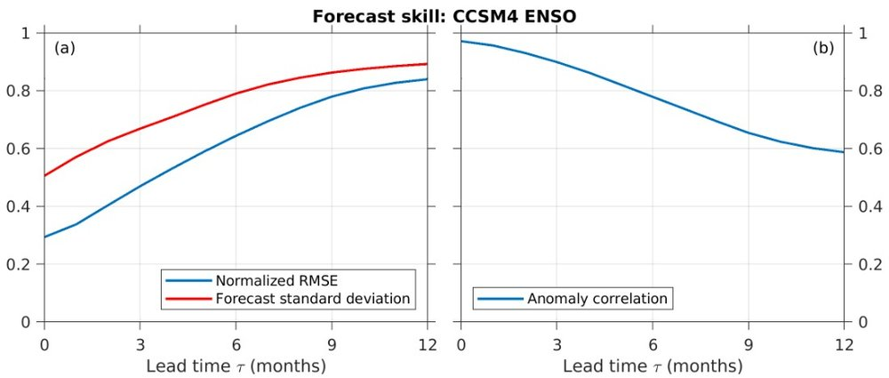</div>
  <figcaption>Figure 5 · Skill of quantum mechanical data assimilation forecasts of Niño 3.4 <span class="paper-credit">From Freeman et al., <em>Proc. Natl. Acad. Sci.</em> 120, e2211115120.</span></figcaption>
</figure>
```

[doi:10.1073/pnas.2211115120](https://doi.org/10.1073/pnas.2211115120){.btn .btn-outline-primary .btn-sm}
[arXiv:2206.13659](https://arxiv.org/abs/2206.13659){.btn .btn-outline-primary .btn-sm}
:::

::: {.paper}
[2022 · *Physical Review A* **105**, 052404]{.paper-meta}

### Embedding classical dynamics in a quantum computer

[D. Giannakis, A. Ourmazd, P. Pfeffer, J. Schumacher and **J. Slawinska**]{.paper-authors}

A framework for simulating measure-preserving, ergodic dynamical systems on a quantum computer,
combining ergodic theory with quantum information science. Classical states become density
operators on a reproducing kernel Hilbert space, so the quantum system stays consistent with the
classical dynamics point by point. Spaces of observables of exponentially large dimension can be
simulated with a quadratic number of quantum gates. The method is tested in simulated circuits and
on the IBM Quantum System One.

```{=html}
<figure class="paper-figure">
  <div class="paper-figure-img"></div>
  <figcaption>Figure 2 · The quantum embedding of classical dynamics, from classical to quantum computational <span class="paper-credit">From Giannakis et al., <em>Phys. Rev. A</em> 105, 052404. © 2022 American Physical Society.</span></figcaption>
</figure>
```

[doi:10.1103/PhysRevA.105.052404](https://doi.org/10.1103/PhysRevA.105.052404){.btn .btn-outline-primary .btn-sm}
[arXiv:2012.06097](https://arxiv.org/abs/2012.06097){.btn .btn-outline-primary .btn-sm}
:::

::: {.paper}
[2021 · *Nature Communications* **12**, 6570 · open access]{.paper-meta}

### Spectral analysis of climate dynamics with operator-theoretic approaches

[G. Froyland, D. Giannakis, B. R. Lintner, M. Pike and **J. Slawinska**]{.paper-authors}

The spectral theory of dynamical systems, combined with data science, extracts coherent modes of
climate variability such as ENSO directly from high-dimensional model and observational data,
without filtering by frequency first. Unlike EOF analysis, which can mix timescales, the
operator-theoretic modes recover several timescales and their interactions, and give improved
composites of the ENSO life cycle.

```{=html}
<figure class="paper-figure">
  <div class="paper-figure-img"></div>
  <figcaption>Figure 1 · The ENSO lifecycle recovered from an eigenfunction of the generator <span class="paper-credit">From Froyland et al., <em>Nat. Commun.</em> 12, 6570.</span></figcaption>
</figure>
```

[doi:10.1038/s41467-021-26357-x](https://doi.org/10.1038/s41467-021-26357-x){.btn .btn-outline-primary .btn-sm}
[arXiv:2104.02902](https://arxiv.org/abs/2104.02902){.btn .btn-outline-primary .btn-sm}
:::

::: {.paper}
[2020 · *Applied and Computational Harmonic Analysis* **54**, 75–136]{.paper-meta}

### Reproducing kernel Hilbert space compactification of unitary evolution groups

[S. Das, D. Giannakis and **J. Slawinska**]{.paper-authors}

A framework for extracting patterns and making predictions in ergodic systems whose spectrum has
both discrete and continuous parts. The generator is approximated by a compact, skew-adjoint
operator on a reproducing kernel Hilbert space, whose spectrum and functional calculus converge to
those of the original system. The unitary evolution it generates approximates the Koopman group.
Examples include a torus rotation and the Lorenz 63 and Rössler systems.

```{=html}
<figure class="paper-figure">
  <div class="paper-figure-img">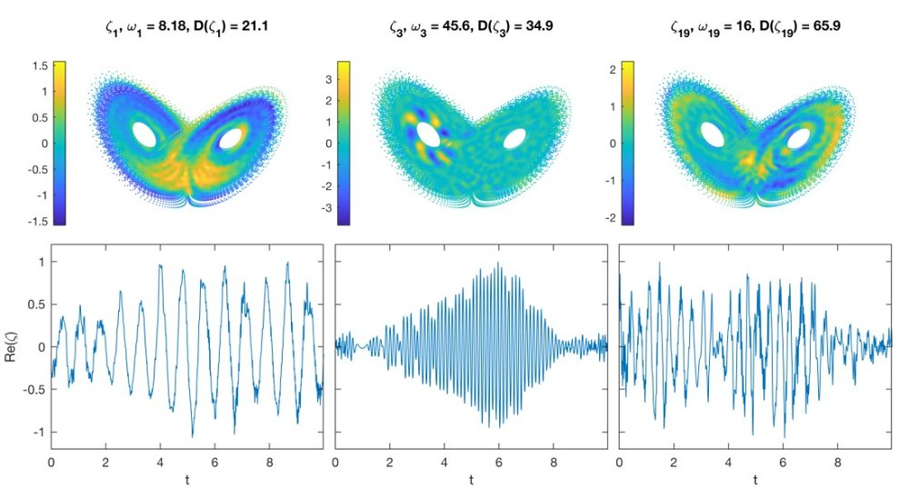</div>
  <figcaption>Figure 7 · Eigenfunctions of the data-driven generator for the Lorenz 63 system <span class="paper-credit">From Das et al., <em>Appl. Comput. Harmon. Anal.</em> 54, 75.</span></figcaption>
</figure>
```

[doi:10.1016/j.acha.2021.02.004](https://doi.org/10.1016/j.acha.2021.02.004){.btn .btn-outline-primary .btn-sm}
[arXiv:1808.01515](https://arxiv.org/abs/1808.01515){.btn .btn-outline-primary .btn-sm}
:::

::: {.paper}
[2020 · *Annals of Mathematics and Artificial Intelligence* **88**, 1155–1173 · open access]{.paper-meta}

### Data-driven Koopman operator approach for computational neuroscience

[N. Marrouch, **J. Slawinska**, D. Giannakis and H. Read]{.paper-authors}

A nonlinear, data-driven Koopman operator method for electrophysiological signals, which splits them
into orthogonal, coherent components and follows their dynamics in space and time. Tested on ECoG
recordings from a mismatch-negativity experiment in marmoset monkeys, it analyses signals in time
and space together, where conventional tools work in one domain at a time.

```{=html}
<figure class="paper-figure">
  <div class="paper-figure-img"></div>
  <figcaption>Figure 4 · Brain-surface maps of the response to a deviant sound, from Koopman eigenfunctions <span class="paper-credit">From Marrouch et al., <em>Ann. Math. Artif. Intell.</em> 88, 1155.</span></figcaption>
</figure>
```

[doi:10.1007/s10472-019-09666-2](https://doi.org/10.1007/s10472-019-09666-2){.btn .btn-outline-primary .btn-sm}
:::

::: {.paper}
[2019 · *Scientific Reports* **10**, 2636 · open access]{.paper-meta}

### Extended-range statistical ENSO prediction through operator-theoretic techniques for nonlinear dynamics

[X. Wang, **J. Slawinska** and D. Giannakis]{.paper-authors}

Statistical ENSO models based on linear dynamics lose skill beyond about half a year, because ENSO
is strongly nonlinear. We use kernel analog forecasting, a nonparametric method grounded in Koopman
operator theory, to predict ENSO as a conditional expectation given noisy and incomplete data at the
start of the forecast, extending useful skill to longer lead times.

```{=html}
<figure class="paper-figure">
  <div class="paper-figure-img"></div>
  <figcaption>Figure 1 · Kernel analog forecasts of the Niño 3.4 index, 1998–2017 <span class="paper-credit">From Wang et al., <em>Sci. Rep.</em> 10, 2636.</span></figcaption>
</figure>
```

[doi:10.1038/s41598-020-59128-7](https://doi.org/10.1038/s41598-020-59128-7){.btn .btn-outline-primary .btn-sm}
[arXiv:1906.09492](https://arxiv.org/abs/1906.09492){.btn .btn-outline-primary .btn-sm}
:::

::: {.paper}
[2019 · ICML Workshop “Climate Change: How Can AI Help?”]{.paper-meta}

### A quantum mechanical approach for data assimilation in climate dynamics

[**J. Slawinska**, A. Ourmazd and D. Giannakis]{.paper-authors}

Data assimilation alternates forecasts with corrections from new observations, much as a quantum
system alternates smooth evolution with measurement. We use that formalism directly. The Koopman
operator, which governs how observables evolve, plays the part of the Heisenberg evolution operator,
and a quantum mechanical density operator holds the current state of knowledge. The scheme is fully
empirical: the evolution and measurement operators are matrices in a basis learned from time-ordered
observations, with no model of the dynamics. Applied to the Niño 3.4 index of ENSO in a comprehensive
climate model, it gives promising results.

```{=html}
<figure class="paper-figure">
  <div class="paper-figure-img"></div>
  <figcaption>Figure 2 · Quantum mechanical data assimilation of the Niño 3.4 index in CCSM4 <span class="paper-credit">From Slawinska et al., ICML 2019 workshop “Climate Change: How Can AI Help?”.</span></figcaption>
</figure>
```

[Paper (NSF PAR)](https://par.nsf.gov/biblio/10111830){.btn .btn-outline-primary .btn-sm}
[Workshop page](https://www.climatechange.ai/papers/icml2019/7){.btn .btn-outline-primary .btn-sm}
:::

::: {.paper}
[2018 · *Journal of Nonlinear Science* **29**, 2385–2445]{.paper-meta}

### Spatiotemporal pattern extraction by spectral analysis of vector-valued observables

[D. Giannakis, A. Ourmazd, **J. Slawinska** and Z. Zhao]{.paper-authors}

Vector-valued spectral analysis (VSA) extracts spatiotemporal patterns from ergodic dynamical
systems by combining operator-valued kernels with delay-coordinate maps. Unlike classical methods,
which split data into separate spatial and temporal modes, VSA patterns need not separate, so a few
modes can capture signals that are intermittent in both space and time. The kernel removes dynamical
symmetries and, with infinitely many delays, commutes with the Koopman operator. Applications include
the Kuramoto–Sivashinsky model.

```{=html}
<figure class="paper-figure">
  <div class="paper-figure-img">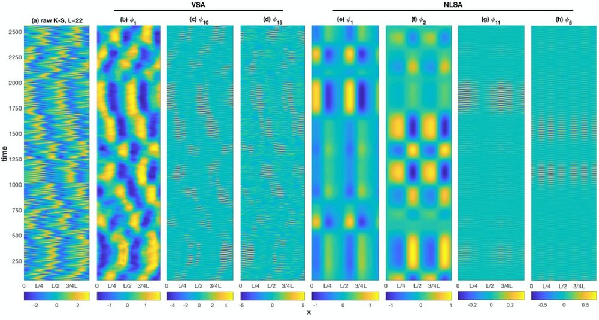</div>
  <figcaption>Figure 2 · Kuramoto–Sivashinsky data and the patterns found by VSA and by NLSA <span class="paper-credit">From Giannakis et al., <em>J. Nonlinear Sci.</em> 29, 2385.</span></figcaption>
</figure>
```

[doi:10.1007/s00332-019-09548-1](https://doi.org/10.1007/s00332-019-09548-1){.btn .btn-outline-primary .btn-sm}
[arXiv:1711.02798](https://arxiv.org/abs/1711.02798){.btn .btn-outline-primary .btn-sm}
:::

::: {.paper}
[2018 · *International Journal of Climatology* **39**, 1026–1040]{.paper-meta}

### Antarctic circumpolar wave and its seasonality: Intrinsic traveling modes and ENSO teleconnections

[X. Wang, D. Giannakis and **J. Slawinska**]{.paper-authors}

Interannual variability of the Southern Ocean, studied with nonlinear Laplacian spectral analysis of
modelled and observed sea surface temperature and sea ice concentration. The method recovers the
eastward-travelling, wavenumber-2 Antarctic circumpolar wave and modes describing how it modulates
the annual cycle. Further modes, with finer structure and more Indian Ocean variance, are traced to
teleconnections with ENSO in the tropical Indo-Pacific.

```{=html}
<figure class="paper-figure">
  <div class="paper-figure-img"></div>
  <figcaption>Figure 3 · Reconstructed Antarctic sea ice anomalies from the circumpolar wave modes <span class="paper-credit">From Wang et al., <em>Int. J. Climatol.</em> 39, 1026.</span></figcaption>
</figure>
```

[doi:10.1002/joc.5860](https://doi.org/10.1002/joc.5860){.btn .btn-outline-primary .btn-sm}
[arXiv:1805.05525](https://arxiv.org/abs/1805.05525){.btn .btn-outline-primary .btn-sm}
:::

::: {.paper}
[2018 · *Journal of Climate* **31**, 693–725]{.paper-meta}

### Indo-Pacific variability on seasonal to multidecadal timescales. Part II: Multiscale atmosphere–ocean linkages

[D. Giannakis and **J. Slawinska**]{.paper-authors}

Using the modes found in Part I, we study coupled atmosphere–ocean variability of the Indo-Pacific in
a millennial CCSM4 run and in observations. ENSO and its combination modes with the annual cycle
carry seasonally synchronized shifts of surface winds that end El Niño and La Niña events and
produce an Indian Ocean dipole-like pattern. On longer timescales, the west Pacific multidecadal mode
modulates ENSO and the tropospheric biennial oscillation, and the modes are linked to decadal
rainfall over Australia.

```{=html}
<figure class="paper-figure">
  <div class="paper-figure-img">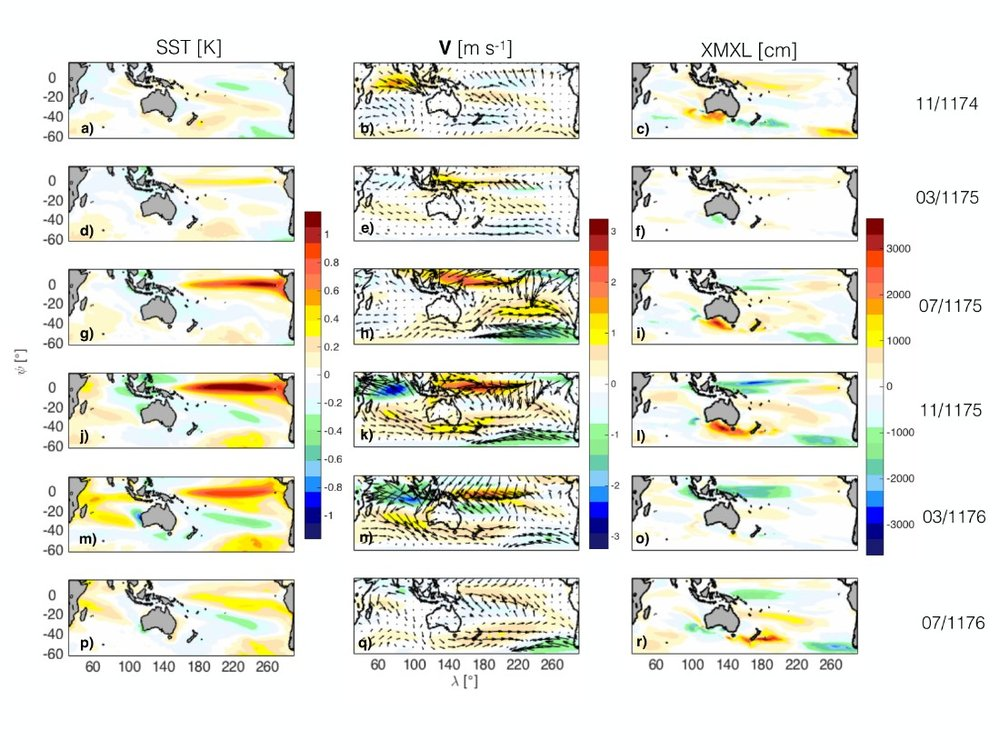</div>
  <figcaption>Figure 1 · SST, surface wind and mixed-layer depth through an El Niño event in CCSM4 <span class="paper-credit">From Giannakis and Slawinska, <em>J. Climate</em> 31, 693.</span></figcaption>
</figure>
```

[doi:10.1175/JCLI-D-17-0031.1](https://doi.org/10.1175/JCLI-D-17-0031.1){.btn .btn-outline-primary .btn-sm}
[arXiv:1609.09185](https://arxiv.org/abs/1609.09185){.btn .btn-outline-primary .btn-sm}
:::

::: {.paper}
[2018 · IEEE Statistical Signal Processing Workshop, 338–342]{.paper-meta}

### A new approach to signal processing of spatiotemporal data

[**J. Slawinska**, A. Ourmazd and D. Giannakis]{.paper-authors}

A conference account, written for the signal processing community, of vector-valued spectral
analysis. Classical tools such as principal component analysis compare whole snapshots of a signal
and return separate spatial and temporal modes. Here a spatiotemporal signal is treated as a
vector-valued observable of a dynamical system, and data points are compared with an
operator-valued kernel, combined with delay embedding, that takes both the temporal and the spatial
degrees of freedom into account. The patterns it returns need not split into a spatial part and a
temporal part, so a few of them can represent signals that are intermittent in both space and time.
The full theory and further examples are in the *Journal of Nonlinear Science* paper listed above.

[doi:10.1109/SSP.2018.8450704](https://doi.org/10.1109/SSP.2018.8450704){.btn .btn-outline-primary .btn-sm}
:::

::: {.paper}
[2018 · International Joint Conference on Neural Networks (IJCNN), 1–10]{.paper-meta}

### Data-driven spectral decomposition of ECoG signal from an auditory oddball experiment in a marmoset monkey: Implications for EEG data in humans

[N. Marrouch, H. Read, **J. Slawinska** and D. Giannakis]{.paper-authors}

Mismatch negativity is the brain's response to a sound that breaks an expected pattern. We present
a data-driven method for extracting its dynamics in space and time from electrocorticographic (ECoG)
recordings of a marmoset monkey. The recordings are treated as observables of a skew-product
dynamical system, and patterns of neural activity are extracted with the operator-theoretic
formulation of ergodic theory. The method separates distinct frequencies in time without any
bandpass filtering. After checking that the results are consistent and statistically significant, we
examine the spatiotemporal dynamics and find that mismatch negativity is driven in part by a
synchronization of the brain's response after a deviation in the auditory stimulus. This work led to
the *Annals of Mathematics and Artificial Intelligence* paper listed above.

[doi:10.1109/IJCNN.2018.8489475](https://doi.org/10.1109/IJCNN.2018.8489475){.btn .btn-outline-primary .btn-sm}
:::

::: {.paper}
[2017 · *Journal of Climate* **30**, 5265–5294]{.paper-meta}

### Indo-Pacific variability on seasonal to multidecadal timescales. Part I: Intrinsic SST modes in models and observations

[**J. Slawinska** and D. Giannakis]{.paper-authors}

Nonlinear Laplacian spectral analysis is applied to Indo-Pacific sea surface temperature in
millennial runs of CCSM4 and GFDL CM3 and in HadISST observations, with no ad hoc filtering of the
data. It recovers a hierarchy of modes: the fundamental ENSO mode, ENSO-modulated annual modes with
strong Indian Ocean dipole activity, a tropospheric biennial oscillation, and a newly identified
west Pacific multidecadal mode.

```{=html}
<figure class="paper-figure">
  <div class="paper-figure-img"></div>
  <figcaption>Figure 2 · Spectra, time series and spatial patterns of three NLSA modes in CCSM4 <span class="paper-credit">From Slawinska and Giannakis, <em>J. Climate</em> 30, 5265.</span></figcaption>
</figure>
```

[doi:10.1175/JCLI-D-16-0176.1](https://doi.org/10.1175/JCLI-D-16-0176.1){.btn .btn-outline-primary .btn-sm}
[arXiv:1604.01742](https://arxiv.org/abs/1604.01742){.btn .btn-outline-primary .btn-sm}
:::

::: {.paper}
[2017 · NIPS Time Series Workshop]{.paper-meta}

### Vector-valued spectral analysis of space-time data

[D. Giannakis, **J. Slawinska**, A. Ourmazd and Z. Zhao]{.paper-authors}

Finding coherent patterns in data from complex dynamical systems is a central problem across science
and engineering. We combine operator-valued kernels with delay embedding to identify such patterns
objectively, with no prior knowledge of the state space or of the laws that generated the data. The
method works on a space of vector-valued observables, with a kernel that measures similarity in both
time and space, where classical techniques such as PCA compare whole snapshots. The resulting
decomposition is more efficient and more physically meaningful than those from scalar-valued
kernels, as shown for an oscillator model and for sea surface temperature from a climate model.

```{=html}
<figure class="paper-figure">
  <div class="paper-figure-img">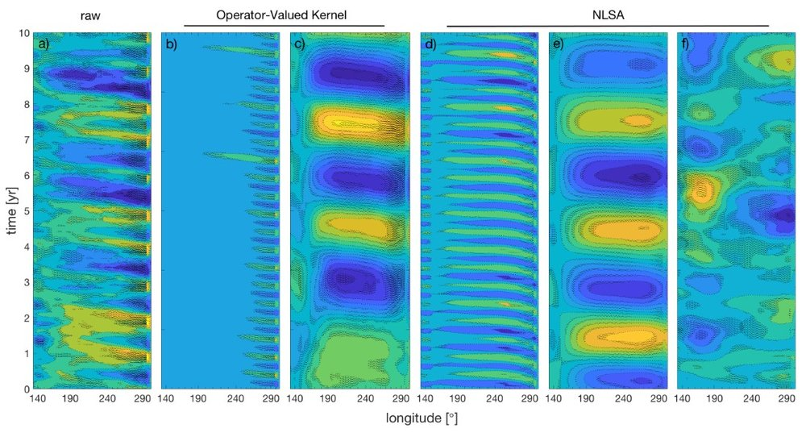</div>
  <figcaption>Figure 2 · Equatorial Pacific SST in CCSM4: raw data and patterns from the operator-valued kernel and from NLSA <span class="paper-credit">From Giannakis et al., arXiv:1805.09134.</span></figcaption>
</figure>
```

[arXiv:1805.09134](https://arxiv.org/abs/1805.09134){.btn .btn-outline-primary .btn-sm}
:::

::: {.paper}
[2017 · SIAM Data Mining, Workshop on Mining Big Data in Climate and Environment]{.paper-meta}

### Data-driven Koopman analysis of tropical climate space-time variability

[**J. Slawinska**, E. Székely and D. Giannakis]{.paper-authors}

A study of the nonlinear dynamics of the Earth's tropical climate with Koopman eigenfunctions, which
give low-dimensional temporal patterns for signals from ergodic dynamical systems. Applied to several
tropical climate datasets, the method extracts a multiscale hierarchy of patterns on timescales from
a day to several years. Without any prefiltering of the data, it detects intraseasonal and faster
modes that correspond to propagating organized convection. We describe these travelling features,
show how the activity of some of them is tied to lower-frequency dynamics, and discuss their
potential predictability.

```{=html}
<figure class="paper-figure">
  <div class="paper-figure-img">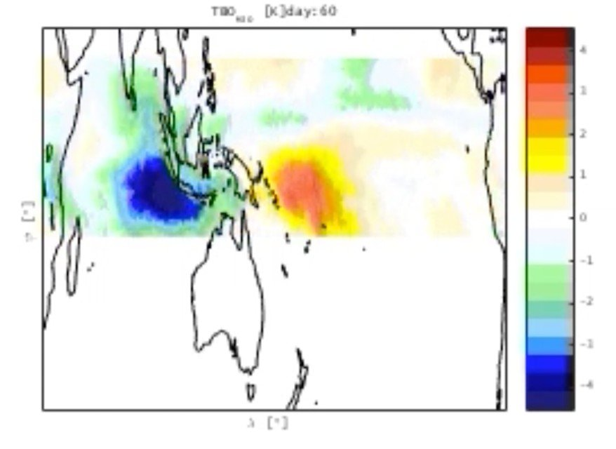</div>
  <figcaption>Figure 1 · Brightness temperature snapshot of the intraseasonal (MJO) mode <span class="paper-credit">From Slawinska et al., arXiv:1711.02526.</span></figcaption>
</figure>
```

[arXiv:1711.02526](https://arxiv.org/abs/1711.02526){.btn .btn-outline-primary .btn-sm}
:::

::: {.paper}
[2016 · 6th International Workshop on Climate Informatics, NCAR Technical Note TN-529, 49–52]{.paper-meta}

### Spatiotemporal pattern extraction with data-driven Koopman operators for convectively coupled equatorial waves

[**J. Slawinska** and D. Giannakis]{.paper-authors}

Organized convection in the tropics takes the form of waves and oscillations across a wide range of
scales. We study its patterns with a feature extraction technique based on eigenfunctions of the
Koopman operator, which governs the evolution of observables in ergodic dynamical systems and gives
low-dimensional representations of spatiotemporal signals. Applied to satellite brightness
temperature data, the method extracts a multiscale hierarchy of patterns on timescales from years
down to days. It includes the Madden–Julian Oscillation and travelling waves with the temporal and
spatial scales of convectively coupled equatorial waves. The activity of some of these waves turns
out to be modulated by intraseasonal modes such as the MJO and the boreal summer intraseasonal
oscillation.

[Proceedings (NSF PAR)](https://par.nsf.gov/biblio/10039222-proceedings-sixth-international-workshop-climate-informatics-ci){.btn .btn-outline-primary .btn-sm}
:::

::: {.paper}
[2015 · *Proceedings of Machine Learning Research* **44**, 103–115 · NIPS workshop]{.paper-meta}

### Spatiotemporal feature extraction with data-driven Koopman operators

[D. Giannakis, **J. Slawinska** and Z. Zhao]{.paper-authors}

A framework for feature extraction and mode decomposition of spatiotemporal data from ergodic
dynamical systems. Instead of kernel operators, the feature maps are built from eigenfunctions of the
Koopman group, the unitary operators that govern how observables evolve. Eigenvalues and
eigenfunctions are computed with a Galerkin scheme from time-ordered data, with no knowledge of the
equations of motion, in a data-driven basis obtained from diffusion maps. The resulting features
separate timescales strongly, are predictable and smooth, and do not depend on how the system is
observed. Examples are superimposed travelling waves on a periodic domain and satellite observations
of organized convection in the tropics.

```{=html}
<figure class="paper-figure">
  <div class="paper-figure-img">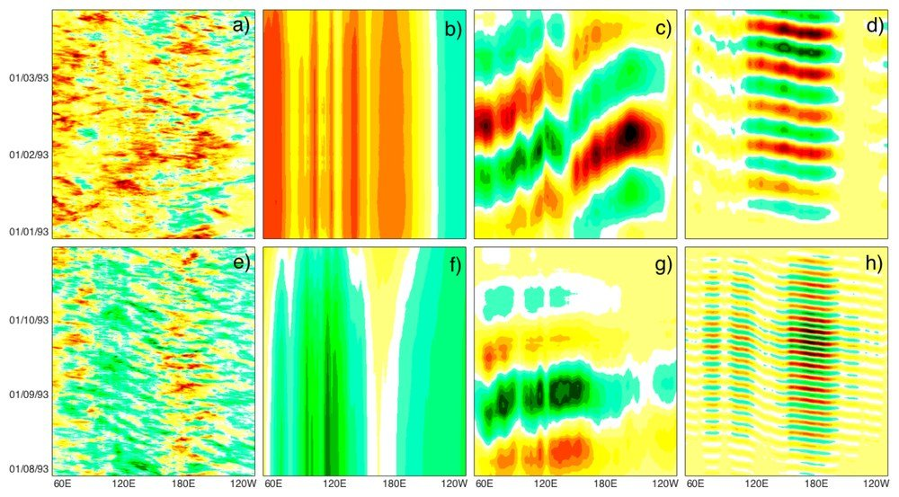</div>
  <figcaption>Figure 3 · Tropical brightness temperature: raw data (a, e) and reconstructions from Koopman eigenfunctions <span class="paper-credit">From Giannakis et al., <em>Proc. Mach. Learn. Res.</em> 44, 103.</span></figcaption>
</figure>
```

[PMLR 44:103–115](https://proceedings.mlr.press/v44/giannakis15.html){.btn .btn-outline-primary .btn-sm}
:::

::: {.paper}
[2012 · *Journal of the Atmospheric Sciences* **69**, 444–462]{.paper-meta}

### Droplet activation and mixing in large-eddy simulation of a shallow cumulus field

[**J. Slawinska**, W. W. Grabowski, H. Pawlowska and H. Morrison]{.paper-authors}

How many droplets a cloud holds, and how large they are, controls how much sunlight it reflects. We
study this in large-eddy simulations of a field of shallow cumulus from the BOMEX campaign, using a
double-moment warm-rain microphysics scheme that predicts supersaturation, so that cloud droplets
can form not only at cloud base but also higher up, wherever rising air becomes supersaturated,
including air drawn in through the sides of the cloud. About 40% of the droplets come from this
in-cloud activation. It offsets the dilution caused by entrainment and keeps the mean droplet
concentration roughly constant with height, as aircraft observations show; without it,
concentrations would fall with height. The activation above cloud base therefore matters for the
effective radius and the albedo of the clouds. The simulations compare pristine and polluted aerosol
conditions and two contrasting assumptions about how cloudy and clear air mix below the grid scale,
homogeneous and extremely inhomogeneous mixing.

<!-- No figure yet. To add one, save it as images/papers/droplet-activation.jpg and copy the figure block
     from another paper here, changing the file name, the description and the caption. -->

[doi:10.1175/JAS-D-11-054.1](https://doi.org/10.1175/JAS-D-11-054.1){.btn .btn-outline-primary .btn-sm}
:::

::: {.paper}
[2011 · *Acta Geophysica* **59**, 1184–1204]{.paper-meta}

### Macroscopic impacts of cloud and precipitation processes in shallow convection

[W. W. Grabowski, **J. Slawinska**, H. Pawlowska and A. A. Wyszogrodzki]{.paper-authors}

The EULAG model with double-moment warm-rain microphysics is applied to the RICO intercomparison
case of precipitating trade-wind cumulus. Pristine and polluted aerosol environments, and
homogeneous against extremely inhomogeneous subgrid mixing, give very different droplet
concentrations and rain, yet the large-scale properties of the cloud field stay much the same.

```{=html}
<figure class="paper-figure">
  <div class="paper-figure-img">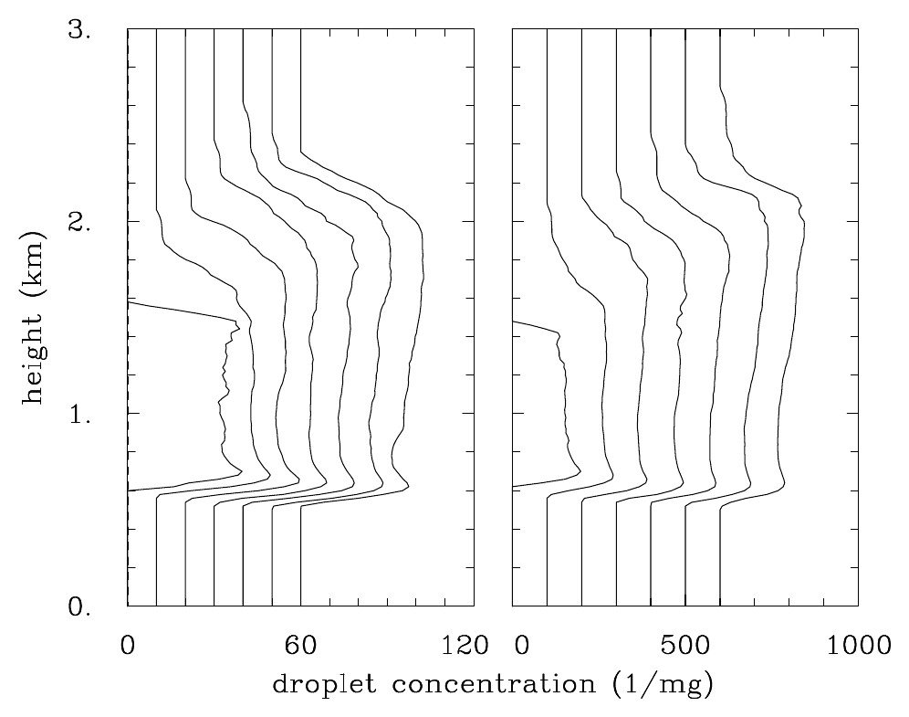</div>
  <figcaption>Figure 7 · Mean cloud droplet profiles in the pristine (left) and polluted (right) runs <span class="paper-credit">From Grabowski et al., <em>Acta Geophys.</em> 59, 1184.</span></figcaption>
</figure>
```

[doi:10.2478/s11600-011-0038-9](https://doi.org/10.2478/s11600-011-0038-9){.btn .btn-outline-primary .btn-sm}
:::

::: {.paper}
[2011 · *Journal of Advances in Modeling Earth Systems* **3**, M06001 · open access]{.paper-meta}

### Controls on precipitation and cloudiness in simulations of trade-wind cumulus as observed during RICO

[M. C. vanZanten, B. Stevens, L. Nuijens, A. P. Siebesma and 15 co-authors, including **J. Slawinska**]{.paper-authors}

A model intercomparison: twelve large-eddy simulations, with very different treatments of cloud
microphysics, are compared with each other and with independent measurements from the undisturbed
period of the RICO field study of rain in trade-wind cumulus. The ensemble average reproduces many
features of the observed clouds, including the vertical structure of cloud fraction and the profiles
of cloud and rain water. The individual models differ considerably in their microphysical structure
and in the surface rain they produce. Simulations that develop rain tend to end with a shallower and
somewhat more stable cloud layer.

```{=html}
<figure class="paper-figure">
  <div class="paper-figure-img"></div>
  <figcaption>Figure 6 · Precipitation flux, fall velocity and surface rain-rate histograms in the twelve models <span class="paper-credit">From vanZanten et al., <em>J. Adv. Model. Earth Syst.</em> 3, M06001. CC BY 3.0.</span></figcaption>
</figure>
```

[doi:10.1029/2011MS000056](https://doi.org/10.1029/2011MS000056){.btn .btn-outline-primary .btn-sm}
:::

::: {.paper .paper-fill}
[2009 · *Quarterly Journal of the Royal Meteorological Society* **135**, 1906–1913]{.paper-meta}

### The impact of atmospheric aerosols on precipitation from deep organized convection: A prescribed-flow model study using double-moment bulk microphysics

[**J. Slawinska**, W. W. Grabowski and H. Morrison]{.paper-authors}

How aerosols change the rain from deep convection is far less well understood than their effect on
shallow clouds. To isolate the role of microphysics, we merge a prescribed-flow model with a
double-moment scheme for warm rain and ice. The two-dimensional flow is fixed in advance and mimics
an idealized squall line: a narrow region of strong convective updraft beside a much wider region of
weak stratiform updraft lying over a stratiform downdraft. With the flow held fixed, the results
imply that surface precipitation from organized convection can differ between pristine and polluted
air only through the feedback of cloud condensation nuclei on the cloud dynamics. In that feedback,
small differences in latent heating for the same flow pattern lead to different flow patterns.

```{=html}
<figure class="paper-figure">
  <div class="paper-figure-img"></div>
  <figcaption>Illustration · Idealized squall line over the Great Plains, cut by a 2-D model plane with its numerical grid <span class="paper-credit">Original illustration; not model output from the paper.</span></figcaption>
</figure>
```

[doi:10.1002/qj.450](https://doi.org/10.1002/qj.450){.btn .btn-outline-primary .btn-sm}
:::

::: {.paper}
[2008 · *Journal of Climate* **21**, 1639–1647]{.paper-meta}

### Optical properties of shallow convective clouds diagnosed from a bulk-microphysics large-eddy simulation

[**J. Slawinska**, W. W. Grabowski, H. Pawlowska and A. A. Wyszogrodzki]{.paper-authors}

Shallow clouds reflect far more sunlight than they trap heat, so their optical properties matter for
climate. Those properties depend on how much liquid water a cloud holds and on the effective radius
of its droplets. A large-eddy simulation with bulk microphysics predicts the liquid water but not the
droplet sizes, so the effective radius has to be diagnosed, and the answer depends on what is
assumed about entrainment and mixing. Shallow cumulus are strongly diluted by the dry air they
entrain. If mixing is homogeneous, all droplets shrink together; if it is extremely inhomogeneous,
some droplets evaporate completely and the rest keep their size. The choice between these
assumptions has a dramatic effect on the albedo of the cloud field.

```{=html}
<figure class="paper-figure">
  <div class="paper-figure-img"></div>
  <figcaption>Figure 1 · Diagnosed effective radius with height for four mixing scenarios, pristine and polluted <span class="paper-credit">From Slawinska et al., <em>J. Climate</em> 21, 1639&ndash;1647. &copy; 2008 American Meteorological Society.</span></figcaption>
</figure>
```

[doi:10.1175/2007JCLI1820.1](https://doi.org/10.1175/2007JCLI1820.1){.btn .btn-outline-primary .btn-sm}
:::

::: {.paper .paper-fill}
[2005 · *Acta Astronomica* **55**, 195–204]{.paper-meta}

### On the nature of regular pulsation in two LBV stars of NGC 300

[W. A. Dziembowski and **J. Slawinska**]{.paper-authors}

Two A-type supergiants in NGC 300 pulsate with striking regularity, with periods of 72.5 and 96.1
days. We treat each star as a linear dynamical system whose eigenfrequencies are complex: a mode
grows or decays according to the sign of the imaginary part. Following sequences of envelope models
of decreasing mass, we track how these eigenfrequencies move in the complex plane. Ordinary
overtones undergo avoided crossings, while a purely thermal, damped mode acquires an oscillatory
character and turns unstable, driven by the opacity mechanism in the iron bump. This strange mode,
with a period near 85 days that shortens to about 73 days, is a good candidate for the regular
variability of the 72.5-day star, and the explanation requires both stars to be significantly
undermassive.

```{=html}
<figure class="paper-figure">
  <div class="paper-figure-img"></div>
  <figcaption>Complex eigenfrequencies of the lowest-order radial modes as the stellar mass decreases <span class="paper-credit">New visualization of results from Dziembowski and Slawinska, <em>Acta Astron.</em> 55, 195.</span></figcaption>
</figure>
```

[PDF](https://acta.astrouw.edu.pl/Vol55/n2/pap_55_2_3.pdf){.btn .btn-outline-primary .btn-sm}
[ADS: 2005AcA....55..195D](https://ui.adsabs.harvard.edu/abs/2005AcA....55..195D){.btn .btn-outline-primary .btn-sm}
:::
