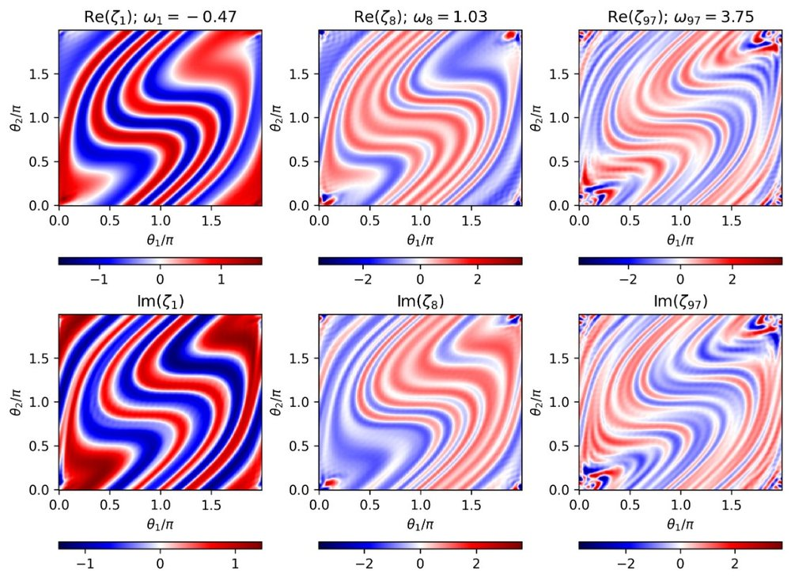
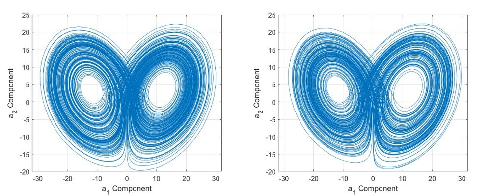
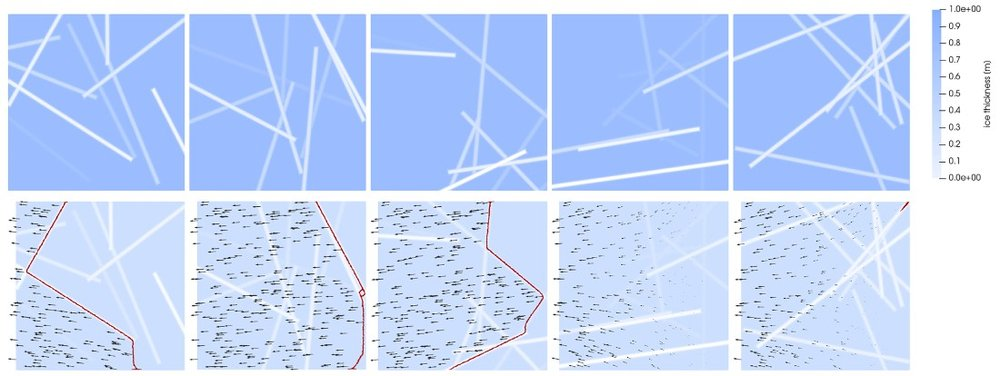
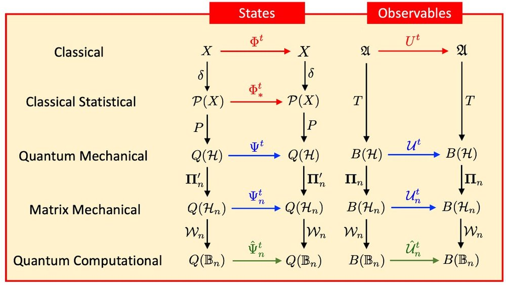
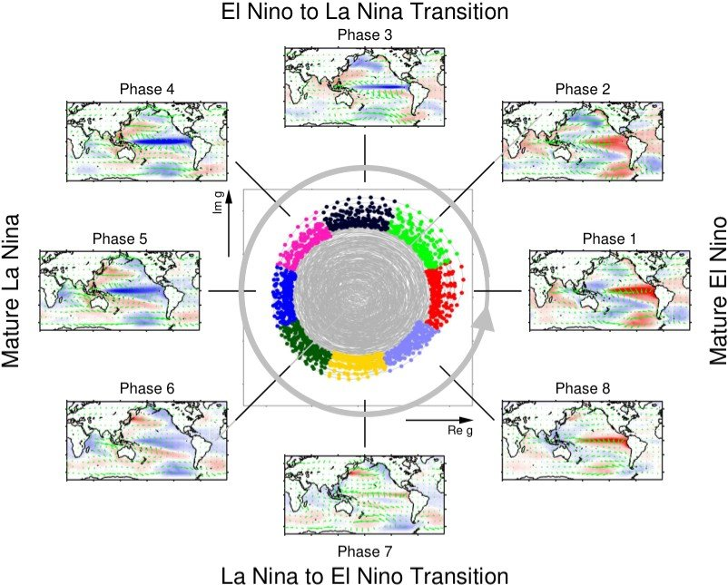
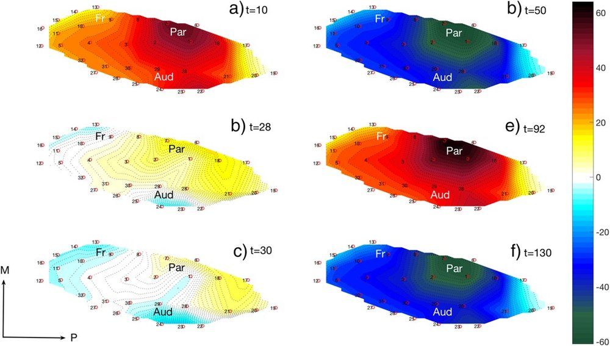
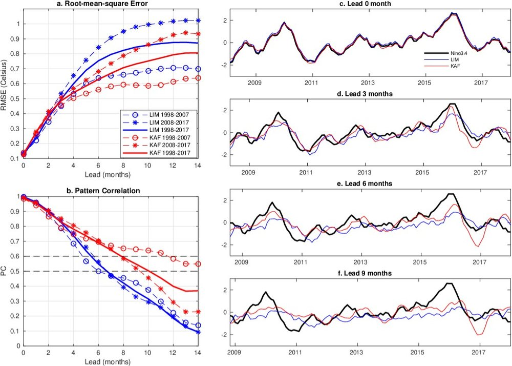
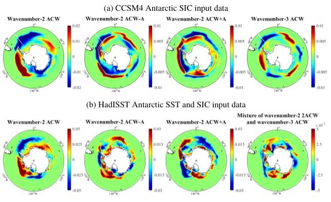
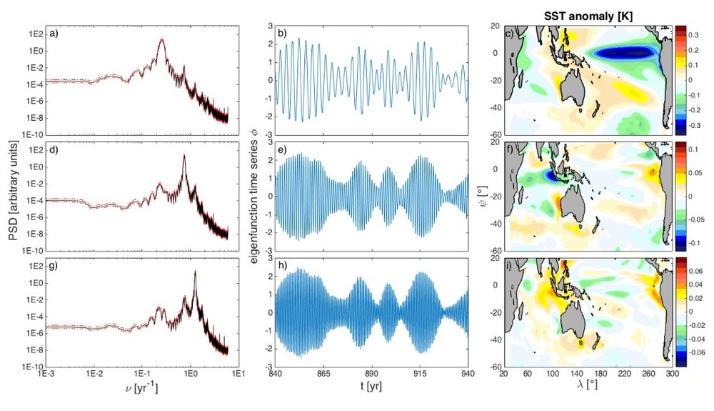

<!-- SELECTED PUBLICATIONS, shown one at a time in the middle of the home page.

     Each paper is one block, newest first, that starts with the line ::: {.paper} and ends with a
     line of three colons. To add a paper, copy a block and change its text. To remove one, delete
     its block. The order here is the order of the arrows.

     Inside a block:
       first line     year and journal, plus [New]{.paper-new} if you want the "New" label
       ### line       the title
       next line      the authors, with your name in **bold**
       paragraph      a short summary (or paste your abstract instead)
       figure         from the line ```{=html} to the next ``` : the picture in images/papers/,
                      a description of it for readers who cannot see it (alt="..."), and the
                      caption under it
       tags line      the topic labels
       last line      the link buttons

     On wide screens every card is as tall as the photo-and-contact column; the picture takes the
     space the text leaves free, so pictures wider than tall fit best.

     The summaries were written in my own words from each paper's abstract. Replace any of them
     with your own abstract if you prefer. -->

::: {.paper}
[2026 · *Nonlinearity* **39**, 115006 · open access]{.paper-meta} [New]{.paper-new}

### Second quantization for classical nonlinear dynamics

[D. Giannakis, M. J. Latifi Jebelli, M. Montgomery, P. Pfeffer, J. Schumacher and **J. Slawinska**]{.paper-authors}

Borrowing tools from many-body quantum theory, we represent the evolution of observables of
ergodic, measure-preserving flows as rotations on tori. Weighted Fock spaces built from reproducing
kernel Hilbert spaces form commutative Banach algebras whose spectra split into tori. Approximate
Koopman operators lift to rotations on these tori, so observables evolve as Fourier polynomials built
from products of approximate Koopman eigenfunctions. The scheme is data-driven, is demonstrated on
the Stepanoff flow and the Lorenz 63 system, and connects naturally to quantum computing.

```{=html}
<figure class="paper-figure">
  <div class="paper-figure-img"></div>
  <figcaption>Figure 4 · Eigenfunctions of the regularized generator for the Stepanoff flow</figcaption>
</figure>
```

[Quantum]{.paper-tag} [Koopman operators]{.paper-tag}

[arXiv:2501.07419](https://arxiv.org/abs/2501.07419){.btn .btn-outline-primary .btn-sm}
:::

::: {.paper}
[2026 · *SIAM Journal on Applied Dynamical Systems* · in press]{.paper-meta}

### Learning dynamical systems with the spectral exterior calculus

[S. Das, D. Giannakis, Y. Gu and **J. Slawinska**]{.paper-authors}

A data-driven method for learning dynamical systems on compact Riemannian manifolds with the
spectral exterior calculus. Vector fields are reconstructed from data in a way that respects the
nonlinear geometry of the manifold, so the flows they generate consistently approximate the true
system. We prove convergence in the limit of large data and illustrate the method numerically.

```{=html}
<figure class="paper-figure">
  <div class="paper-figure-img"></div>
  <figcaption>Figure 2 · True (red) and SEC-approximated (blue) vector fields on the circle</figcaption>
</figure>
```

[Machine learning]{.paper-tag} [Geometry]{.paper-tag}

[arXiv:2505.06061](https://arxiv.org/abs/2505.06061){.btn .btn-outline-primary .btn-sm}
:::

::: {.paper}
[2026 · *Journal of Climate* **39**, 3905–3930]{.paper-meta}

### A Koopman interpretation of the recharge oscillator model for ENSO

[T. Carr, D. Giannakis, B. R. Lintner, **J. Slawinska** and C. C. Ummenhofer]{.paper-authors}

The recharge oscillator describes ENSO with two coupled equations for equatorial sea surface
temperature and thermocline depth, but it is ambiguous about what makes El Niño and La Niña
asymmetric. We treat the two quantities as observables of a dynamical system and model their
evolution with the Koopman operator. ENSO is still a single eigenmode, but a learned nonlinear one,
so it can evolve asymmetrically. A simple model built on this eigenmode reproduces key asymmetries
in the CESM2 preindustrial simulation: El Niños decay faster in spring, multiyear La Niñas are more
common, and La Niña anomalies sit further west. The framework may help explain why climate models
disagree about how ENSO will change.

<!-- No figure yet. To add one, save it as images/papers/recharge-oscillator.jpg and copy the figure block
     from another paper here, changing the file name, the description and the caption. -->

[Climate]{.paper-tag} [ENSO]{.paper-tag} [Koopman operators]{.paper-tag}

[doi:10.1175/JCLI-D-25-0527.1](https://doi.org/10.1175/JCLI-D-25-0527.1){.btn .btn-outline-primary .btn-sm}
:::

::: {.paper}
[2026 · *Journal of Computational Physics* **562**, 114992]{.paper-meta}

### Quantum mechanical closure of partial differential equations with symmetries

[C. Vales, D. C. Freeman, **J. Slawinska** and D. Giannakis]{.paper-authors}

A framework for closing PDE models whose small scales are not resolved. The classical dynamics is
embedded in a quantum mechanical system: quantum states represent the unresolved degrees of freedom
statistically, and quantum measurement predicts their effect on the resolved scales. A
positivity-preserving discretization gives a compressed model that respects the symmetries of the
dynamics. For the shallow water equations it reproduces the main features of the true dynamics,
including from initial conditions it was not trained on.

```{=html}
<figure class="paper-figure">
  <div class="paper-figure-img"></div>
  <figcaption>Figure 1 · Space-time heatmaps of kernel eigenfunctions used by the closure</figcaption>
</figure>
```

[Quantum]{.paper-tag} [Closure]{.paper-tag} [Fluids]{.paper-tag}

[doi:10.1016/j.jcp.2026.114992](https://doi.org/10.1016/j.jcp.2026.114992){.btn .btn-outline-primary .btn-sm}
[arXiv:2505.07519](https://arxiv.org/abs/2505.07519){.btn .btn-outline-primary .btn-sm}
:::

::: {.paper}
[2025 · preprint, in revision]{.paper-meta}

### Tensor network approximation of Koopman operators

[D. Giannakis, M. J. Latifi Jebelli, M. Montgomery, P. Pfeffer, J. Schumacher and **J. Slawinska**]{.paper-authors}

A tensor network scheme for approximating how observables of measure-preserving ergodic systems
evolve. A regularized Koopman generator on a reproducing kernel Hilbert space is lifted to a Fock
space, where it acts multiplicatively under the tensor product, and the evolution becomes the
evaluation of a tree tensor network. From a modest set of eigenfunctions, this quantum-inspired
approximation draws on a tensor product space of very large dimension, and it preserves positivity.

```{=html}
<figure class="paper-figure">
  <div class="paper-figure-img"></div>
  <figcaption>Figure 1 · Evolution of quantum states and observables, from Hilbert space to Fock space</figcaption>
</figure>
```

[Quantum]{.paper-tag} [Koopman operators]{.paper-tag}

[arXiv:2407.07242](https://arxiv.org/abs/2407.07242){.btn .btn-outline-primary .btn-sm}
:::

::: {.paper}
[2024 · *Nature Communications* **15**, 4268]{.paper-meta}

### Revealing trends and persistent cycles of non-autonomous systems with autonomous operator-theoretic techniques

[G. Froyland, D. Giannakis, E. Luna and **J. Slawinska**]{.paper-authors}

Forced systems such as the climate are usually studied with ensembles of experiments. We show that
eigenfunctions of Koopman and transfer operators, built for autonomous systems, can identify
nonlinear trends and persistent cycles of forced systems from a single trajectory. Applications
include sea surface temperature over the industrial era and the mid-Pleistocene transition of
glaciation cycles, where the 40,000-year cycle is recovered from benthic δ¹⁸O records.

```{=html}
<figure class="paper-figure">
  <div class="paper-figure-img"></div>
  <figcaption>Figure 10 · Trend and glacial cycles in the δ¹⁸O record of the past 3 million years</figcaption>
</figure>
```

[Climate]{.paper-tag} [Koopman operators]{.paper-tag}

[doi:10.1038/s41467-024-48033-6](https://doi.org/10.1038/s41467-024-48033-6){.btn .btn-outline-primary .btn-sm}
[arXiv:2308.04045](https://arxiv.org/abs/2308.04045){.btn .btn-outline-primary .btn-sm}
:::

::: {.paper}
[2024 · *Multiscale Modeling & Simulation* **22**, 283–333]{.paper-meta}

### Quantum mechanics for closure of dynamical systems

[D. Freeman, D. Giannakis and **J. Slawinska**]{.paper-authors}

A data-driven way to parameterize the unresolved part of a dynamical system with quantum mechanics
and Koopman operator theory. A surrogate system carries a quantum state, a density operator that
evolves under the Koopman operator and supplies the fluxes from the unresolved variables at each
step. New values of the resolved variables update it through a quantum Bayes rule. Kernel methods
turn states, observables and evolution operators into matrices, so the schemes preserve positivity
automatically.

```{=html}
<figure class="paper-figure">
  <div class="paper-figure-img"></div>
  <figcaption>Figure 2 · Lorenz 63 trajectories: true dynamics (a) and the quantum mechanical closure (b)</figcaption>
</figure>
```

[Quantum]{.paper-tag} [Closure]{.paper-tag}

[doi:10.1137/22M1514246](https://doi.org/10.1137/22M1514246){.btn .btn-outline-primary .btn-sm}
[arXiv:2208.03390](https://arxiv.org/abs/2208.03390){.btn .btn-outline-primary .btn-sm}
:::

::: {.paper}
[2024 · preprint]{.paper-meta}

### Koopman spectral analysis of skew-product dynamics on Hilbert C\*-modules

[D. Giannakis, Y. Hashimoto, M. Ikeda, I. Ishikawa and **J. Slawinska**]{.paper-authors}

We introduce a linear operator on a Hilbert C\*-module, defined by composition and multiplication,
for analysing skew-product dynamical systems. It admits an eigenoperator decomposition that
generalizes the eigenvalue decomposition and reconstructs the Koopman operator, representing its
continuous spectrum through eigenoperators. The construction is related to cocycles and Oseledets
subspaces, and helps characterize coherent structures under skew-product dynamics.

```{=html}
<figure class="paper-figure">
  <div class="paper-figure-img"></div>
  <figcaption>Figure 2 · Real part of an eigenoperator of the skew-product system</figcaption>
</figure>
```

[Koopman operators]{.paper-tag} [Operator algebras]{.paper-tag}

[arXiv:2307.08965](https://arxiv.org/abs/2307.08965){.btn .btn-outline-primary .btn-sm}
:::

::: {.paper}
[2023 · *Geophysical Research Letters* **50**, e2023GL102743]{.paper-meta}

### Identification of the Madden–Julian Oscillation with data-driven Koopman spectral analysis

[B. R. Lintner, D. Giannakis, M. Pike and **J. Slawinska**]{.paper-authors}

The Madden–Julian Oscillation is the main source of tropical variability over weeks to months, and
is usually tracked with indices built from empirical orthogonal functions. We extract it instead with
data-driven Koopman spectral analysis of daily outgoing longwave radiation and zonal winds, giving
an operator-theoretic picture of the oscillation to set beside the conventional indices.

```{=html}
<figure class="paper-figure">
  <div class="paper-figure-img"></div>
  <figcaption>Figure 1 · MJO phase space from the RMM index (left) and from Koopman eigenfunctions (right)</figcaption>
</figure>
```

[Climate]{.paper-tag} [MJO]{.paper-tag} [Koopman operators]{.paper-tag}

[doi:10.1029/2023GL102743](https://doi.org/10.1029/2023GL102743){.btn .btn-outline-primary .btn-sm}
:::

::: {.paper}
[2023 · *The Cryosphere* **17**, 3883–3893 · open access]{.paper-meta}

### Phase-field models of floe fracture in sea ice

[H. Dinh, D. Giannakis, **J. Slawinska** and G. Stadler]{.paper-authors}

A phase-field model of brittle fracture for kilometre-sized sea ice floes, which balances the energy
of elastic deformation against the energy it costs to crack. Floes with random thickness variations,
standing for refrozen cracks and other impurities, are loaded at their edges to study their
strength. The orientation of the thickness variations turns out to control both the strength of a
floe and the direction of its cracks. Applications to discrete element simulations and to field data
from the ICEX 2018 campaign are discussed.

```{=html}
<figure class="paper-figure">
  <div class="paper-figure-img"></div>
  <figcaption>Figure 3 · Random ice-thickness fields (top) and the fractures they produce (bottom)</figcaption>
</figure>
```

[Sea ice]{.paper-tag} [Numerical modeling]{.paper-tag}

[doi:10.5194/tc-17-3883-2023](https://doi.org/10.5194/tc-17-3883-2023){.btn .btn-outline-primary .btn-sm}
:::

::: {.paper}
[2023 · *Proceedings of the National Academy of Sciences* **120**, e2211115120]{.paper-meta}

### Data assimilation in operator algebras

[D. Freeman, D. Giannakis, B. Mintz, A. Ourmazd and **J. Slawinska**]{.paper-authors}

An algebraic framework for sequential data assimilation. Bayesian filtering is embedded in a
non-abelian operator algebra, where observables become multiplication operators and probability
densities become quantum states. The forecast step is a quantum operation induced by the Koopman
operator, and the analysis step is a quantum effect that generalizes Bayes' rule. The
finite-dimensional versions preserve positivity, can be learned from data with kernel methods, and
suit quantum computers; they show promising skill for the Lorenz 96 multiscale system and for ENSO
in a climate model.

```{=html}
<figure class="paper-figure">
  <div class="paper-figure-img"></div>
  <figcaption>Figure 5 · Skill of quantum mechanical data assimilation forecasts of Niño 3.4</figcaption>
</figure>
```

[Quantum]{.paper-tag} [Data assimilation]{.paper-tag} [ENSO]{.paper-tag}

[doi:10.1073/pnas.2211115120](https://doi.org/10.1073/pnas.2211115120){.btn .btn-outline-primary .btn-sm}
[arXiv:2206.13659](https://arxiv.org/abs/2206.13659){.btn .btn-outline-primary .btn-sm}
:::

::: {.paper}
[2022 · *Physical Review A* **105**, 052404]{.paper-meta}

### Embedding classical dynamics in a quantum computer

[D. Giannakis, A. Ourmazd, P. Pfeffer, J. Schumacher and **J. Slawinska**]{.paper-authors}

A framework for simulating measure-preserving, ergodic dynamical systems on a quantum computer,
combining ergodic theory with quantum information science. Classical states become density
operators on a reproducing kernel Hilbert space, so the quantum system stays consistent with the
classical dynamics point by point. Spaces of observables of exponentially large dimension can be
simulated with a quadratic number of quantum gates. The method is tested in simulated circuits and
on the IBM Quantum System One.

```{=html}
<figure class="paper-figure">
  <div class="paper-figure-img"></div>
  <figcaption>Figure 2 · The quantum embedding of classical dynamics, from classical to quantum computational</figcaption>
</figure>
```

[Quantum]{.paper-tag} [Quantum computing]{.paper-tag}

[doi:10.1103/PhysRevA.105.052404](https://doi.org/10.1103/PhysRevA.105.052404){.btn .btn-outline-primary .btn-sm}
[arXiv:2012.06097](https://arxiv.org/abs/2012.06097){.btn .btn-outline-primary .btn-sm}
:::

::: {.paper}
[2021 · *Nature Communications* **12**, 6570 · open access]{.paper-meta}

### Spectral analysis of climate dynamics with operator-theoretic approaches

[G. Froyland, D. Giannakis, B. R. Lintner, M. Pike and **J. Slawinska**]{.paper-authors}

The spectral theory of dynamical systems, combined with data science, extracts coherent modes of
climate variability such as ENSO directly from high-dimensional model and observational data,
without filtering by frequency first. Unlike EOF analysis, which can mix timescales, the
operator-theoretic modes recover several timescales and their interactions, and give improved
composites of the ENSO life cycle.

```{=html}
<figure class="paper-figure">
  <div class="paper-figure-img"></div>
  <figcaption>Figure 1 · The ENSO lifecycle recovered from an eigenfunction of the generator</figcaption>
</figure>
```

[Climate]{.paper-tag} [ENSO]{.paper-tag} [Koopman operators]{.paper-tag}

[doi:10.1038/s41467-021-26357-x](https://doi.org/10.1038/s41467-021-26357-x){.btn .btn-outline-primary .btn-sm}
[arXiv:2104.02902](https://arxiv.org/abs/2104.02902){.btn .btn-outline-primary .btn-sm}
:::

::: {.paper}
[2020 · *Applied and Computational Harmonic Analysis* **54**, 75–136]{.paper-meta}

### Reproducing kernel Hilbert space compactification of unitary evolution groups

[S. Das, D. Giannakis and **J. Slawinska**]{.paper-authors}

A framework for extracting patterns and making predictions in ergodic systems whose spectrum has
both discrete and continuous parts. The generator is approximated by a compact, skew-adjoint
operator on a reproducing kernel Hilbert space, whose spectrum and functional calculus converge to
those of the original system. The unitary evolution it generates approximates the Koopman group.
Examples include a torus rotation and the Lorenz 63 and Rössler systems.

```{=html}
<figure class="paper-figure">
  <div class="paper-figure-img"></div>
  <figcaption>Figure 7 · Eigenfunctions of the data-driven generator for the Lorenz 63 system</figcaption>
</figure>
```

[Koopman operators]{.paper-tag} [Kernel methods]{.paper-tag}

[doi:10.1016/j.acha.2021.02.004](https://doi.org/10.1016/j.acha.2021.02.004){.btn .btn-outline-primary .btn-sm}
[arXiv:1808.01515](https://arxiv.org/abs/1808.01515){.btn .btn-outline-primary .btn-sm}
:::

::: {.paper}
[2020 · *Annals of Mathematics and Artificial Intelligence* **88**, 1155–1173 · open access]{.paper-meta}

### Data-driven Koopman operator approach for computational neuroscience

[N. Marrouch, **J. Slawinska**, D. Giannakis and H. Read]{.paper-authors}

A nonlinear, data-driven Koopman operator method for electrophysiological signals, which splits them
into orthogonal, coherent components and follows their dynamics in space and time. Tested on ECoG
recordings from a mismatch-negativity experiment in marmoset monkeys, it analyses signals in time
and space together, where conventional tools work in one domain at a time.

```{=html}
<figure class="paper-figure">
  <div class="paper-figure-img"></div>
  <figcaption>Figure 4 · Brain-surface maps of the response to a deviant sound, from Koopman eigenfunctions</figcaption>
</figure>
```

[Neuroscience]{.paper-tag} [Koopman operators]{.paper-tag}

[doi:10.1007/s10472-019-09666-2](https://doi.org/10.1007/s10472-019-09666-2){.btn .btn-outline-primary .btn-sm}
:::

::: {.paper}
[2019 · *Scientific Reports* **10**, 2636 · open access]{.paper-meta}

### Extended-range statistical ENSO prediction through operator-theoretic techniques for nonlinear dynamics

[X. Wang, **J. Slawinska** and D. Giannakis]{.paper-authors}

Statistical ENSO models based on linear dynamics lose skill beyond about half a year, because ENSO
is strongly nonlinear. We use kernel analog forecasting, a nonparametric method grounded in Koopman
operator theory, to predict ENSO as a conditional expectation given noisy and incomplete data at the
start of the forecast, extending useful skill to longer lead times.

```{=html}
<figure class="paper-figure">
  <div class="paper-figure-img"></div>
  <figcaption>Figure 1 · Kernel analog forecasts of the Niño 3.4 index, 1998–2017</figcaption>
</figure>
```

[Climate]{.paper-tag} [ENSO]{.paper-tag} [Forecasting]{.paper-tag}

[doi:10.1038/s41598-020-59128-7](https://doi.org/10.1038/s41598-020-59128-7){.btn .btn-outline-primary .btn-sm}
[arXiv:1906.09492](https://arxiv.org/abs/1906.09492){.btn .btn-outline-primary .btn-sm}
:::

::: {.paper}
[2018 · *Journal of Nonlinear Science* **29**, 2385–2445]{.paper-meta}

### Spatiotemporal pattern extraction by spectral analysis of vector-valued observables

[D. Giannakis, A. Ourmazd, **J. Slawinska** and Z. Zhao]{.paper-authors}

Vector-valued spectral analysis (VSA) extracts spatiotemporal patterns from ergodic dynamical
systems by combining operator-valued kernels with delay-coordinate maps. Unlike classical methods,
which split data into separate spatial and temporal modes, VSA patterns need not separate, so a few
modes can capture signals that are intermittent in both space and time. The kernel removes dynamical
symmetries and, with infinitely many delays, commutes with the Koopman operator. Applications include
the Kuramoto–Sivashinsky model.

```{=html}
<figure class="paper-figure">
  <div class="paper-figure-img"></div>
  <figcaption>Figure 2 · Kuramoto–Sivashinsky data and the patterns found by VSA and by NLSA</figcaption>
</figure>
```

[Pattern extraction]{.paper-tag} [Kernel methods]{.paper-tag}

[doi:10.1007/s00332-019-09548-1](https://doi.org/10.1007/s00332-019-09548-1){.btn .btn-outline-primary .btn-sm}
[arXiv:1711.02798](https://arxiv.org/abs/1711.02798){.btn .btn-outline-primary .btn-sm}
:::

::: {.paper}
[2018 · *International Journal of Climatology* **39**, 1026–1040]{.paper-meta}

### Antarctic circumpolar wave and its seasonality: Intrinsic traveling modes and ENSO teleconnections

[X. Wang, D. Giannakis and **J. Slawinska**]{.paper-authors}

Interannual variability of the Southern Ocean, studied with nonlinear Laplacian spectral analysis of
modelled and observed sea surface temperature and sea ice concentration. The method recovers the
eastward-travelling, wavenumber-2 Antarctic circumpolar wave and modes describing how it modulates
the annual cycle. Further modes, with finer structure and more Indian Ocean variance, are traced to
teleconnections with ENSO in the tropical Indo-Pacific.

```{=html}
<figure class="paper-figure">
  <div class="paper-figure-img"></div>
  <figcaption>Figure 3 · Reconstructed Antarctic sea ice anomalies from the circumpolar wave modes</figcaption>
</figure>
```

[Climate]{.paper-tag} [Southern Ocean]{.paper-tag}

[doi:10.1002/joc.5860](https://doi.org/10.1002/joc.5860){.btn .btn-outline-primary .btn-sm}
[arXiv:1805.05525](https://arxiv.org/abs/1805.05525){.btn .btn-outline-primary .btn-sm}
:::

::: {.paper}
[2018 · *Journal of Climate* **31**, 693–725]{.paper-meta}

### Indo-Pacific variability on seasonal to multidecadal timescales. Part II: Multiscale atmosphere–ocean linkages

[D. Giannakis and **J. Slawinska**]{.paper-authors}

Using the modes found in Part I, we study coupled atmosphere–ocean variability of the Indo-Pacific in
a millennial CCSM4 run and in observations. ENSO and its combination modes with the annual cycle
carry seasonally synchronized shifts of surface winds that end El Niño and La Niña events and
produce an Indian Ocean dipole-like pattern. On longer timescales, the west Pacific multidecadal mode
modulates ENSO and the tropospheric biennial oscillation, and the modes are linked to decadal
rainfall over Australia.

```{=html}
<figure class="paper-figure">
  <div class="paper-figure-img"></div>
  <figcaption>Figure 1 · SST, surface wind and mixed-layer depth through an El Niño event in CCSM4</figcaption>
</figure>
```

[Climate]{.paper-tag} [ENSO]{.paper-tag}

[doi:10.1175/JCLI-D-17-0031.1](https://doi.org/10.1175/JCLI-D-17-0031.1){.btn .btn-outline-primary .btn-sm}
[arXiv:1609.09185](https://arxiv.org/abs/1609.09185){.btn .btn-outline-primary .btn-sm}
:::

::: {.paper}
[2017 · *Journal of Climate* **30**, 5265–5294]{.paper-meta}

### Indo-Pacific variability on seasonal to multidecadal timescales. Part I: Intrinsic SST modes in models and observations

[**J. Slawinska** and D. Giannakis]{.paper-authors}

Nonlinear Laplacian spectral analysis is applied to Indo-Pacific sea surface temperature in
millennial runs of CCSM4 and GFDL CM3 and in HadISST observations, with no ad hoc filtering of the
data. It recovers a hierarchy of modes: the fundamental ENSO mode, ENSO-modulated annual modes with
strong Indian Ocean dipole activity, a tropospheric biennial oscillation, and a newly identified
west Pacific multidecadal mode.

```{=html}
<figure class="paper-figure">
  <div class="paper-figure-img"></div>
  <figcaption>Figure 2 · Spectra, time series and spatial patterns of three NLSA modes in CCSM4</figcaption>
</figure>
```

[Climate]{.paper-tag} [ENSO]{.paper-tag} [Pattern extraction]{.paper-tag}

[doi:10.1175/JCLI-D-16-0176.1](https://doi.org/10.1175/JCLI-D-16-0176.1){.btn .btn-outline-primary .btn-sm}
[arXiv:1604.01742](https://arxiv.org/abs/1604.01742){.btn .btn-outline-primary .btn-sm}
:::

::: {.paper}
[2012 · *Journal of the Atmospheric Sciences* **69**, 444–462]{.paper-meta}

### Droplet activation and mixing in large-eddy simulation of a shallow cumulus field

[**J. Slawinska**, W. W. Grabowski, H. Pawlowska and H. Morrison]{.paper-authors}

Large-eddy simulations of a field of shallow cumulus from the BOMEX campaign, with a double-moment
warm-rain microphysics scheme that predicts supersaturation and lets droplets activate above cloud
base. About 40% of the droplets come from this in-cloud activation, which keeps droplet
concentration roughly constant with height, as aircraft observe, and affects the effective radius
and albedo of the clouds. Pristine and polluted aerosol conditions and two contrasting subgrid
mixing scenarios are compared.

<!-- No figure yet. To add one, save it as images/papers/droplet-activation.jpg and copy the figure block
     from another paper here, changing the file name, the description and the caption. -->

[Clouds]{.paper-tag} [Large-eddy simulation]{.paper-tag}

[doi:10.1175/JAS-D-11-054.1](https://doi.org/10.1175/JAS-D-11-054.1){.btn .btn-outline-primary .btn-sm}
:::

::: {.paper}
[2011 · *Acta Geophysica* **59**, 1184–1204]{.paper-meta}

### Macroscopic impacts of cloud and precipitation processes in shallow convection

[W. W. Grabowski, **J. Slawinska**, H. Pawlowska and A. A. Wyszogrodzki]{.paper-authors}

The EULAG model with double-moment warm-rain microphysics is applied to the RICO intercomparison
case of precipitating trade-wind cumulus. Pristine and polluted aerosol environments, and
homogeneous against extremely inhomogeneous subgrid mixing, give very different droplet
concentrations and rain, yet the large-scale properties of the cloud field stay much the same.

```{=html}
<figure class="paper-figure">
  <div class="paper-figure-img"></div>
  <figcaption>Figure 7 · Mean cloud droplet profiles in the pristine (left) and polluted (right) runs</figcaption>
</figure>
```

[Clouds]{.paper-tag} [Large-eddy simulation]{.paper-tag}

[doi:10.2478/s11600-011-0038-9](https://doi.org/10.2478/s11600-011-0038-9){.btn .btn-outline-primary .btn-sm}
:::
