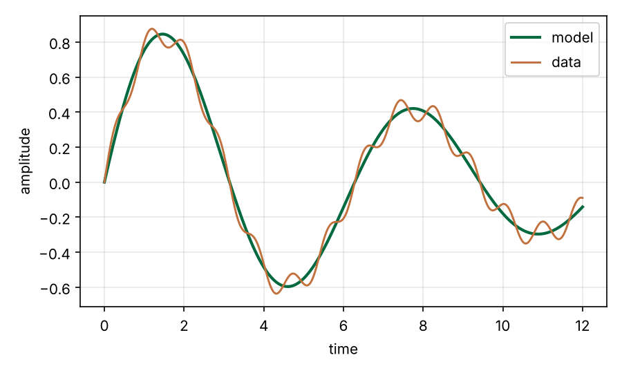

This post exists to show how a post is put together. Copy its folder to start a new one, rename the
folder with a date and a short name, and replace the text.

A post is a folder inside `blog/posts/`. The folder holds `index.qmd`, the text, and any pictures
the post uses. Nothing else needs changing: the Blog page and the home page pick up new posts by
themselves, newest first.

## The header

The lines at the top of this file, between the `---` marks, are what the rest of the site reads:

- `title` and `date` appear above the post and in the lists.
- `description` is the summary shown on the home page and the Blog page. Keep it to a sentence or
  two. You can use `*italics*` in it.
- `image` is the picture shown beside the summary in those lists. It is usually the post's main
  figure. `image-alt` describes it for a reader who cannot see it.
- `categories` are the tags shown on the Blog page, which readers can filter by.

## Writing

Normal paragraphs are just text. You can use **bold**, *italics* and
[links](https://quarto.org/docs/authoring/markdown-basics.html).

Mathematics works inline, $e^{i\pi} + 1 = 0$, and on its own line:

$$
\frac{\partial u}{\partial t} = \nabla^2 u.
$$

Pictures sit in the post's own folder and are included like this, with a caption and a description:

{fig-alt="Two curves that oscillate and decay with time."}

> A quotation, for something worth setting apart.

Code can be shown with three backticks:

```python
import numpy as np
x = np.linspace(0, 12, 400)
```
