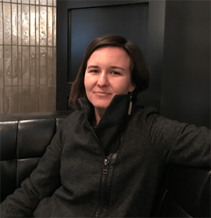

::::: {.home-columns}

:::: {.home-col .home-left}
{fig-alt="Photograph of Joanna Slawinska"}

```{=html}
<h1 class="home-title">Joanna Slawinska</h1>
<p class="home-subtitle">Research Assistant Professor<br>Department of Mathematics<br>Dartmouth College</p>
```

## Contact

Department of Mathematics\
Dartmouth College\
Hanover, NH, United States

[joanna.m.slawinska@dartmouth.edu](mailto:joanna.m.slawinska@dartmouth.edu)

::: {.home-links}
[Project website: DoW NH24-8392](https://nh24-8392.github.io/public-website/){.btn .btn-outline-primary}
[Google Scholar](https://scholar.google.com/citations?user=XTLyFDAAAAAJ&hl=en){.btn .btn-outline-primary}
[ORCID](https://orcid.org/0000-0003-3099-5136){.btn .btn-outline-primary}
[LinkedIn](https://www.linkedin.com/in/joanna-slawinska-dartmouth/){.btn .btn-outline-primary}
[About me →](about.qmd){.btn .btn-outline-primary .about-me-link}
:::

::::

:::: {.home-col .home-mid}
::: {.papers-head}
## Selected publications

[All publications →](about.qmd#publications){.papers-all}
:::

::: {.paper-browser}

:::
::::

:::: {.home-col .home-right}
## Selected projects

<!-- PROJECTS. Each project has a card here and its own page in the projects/ folder. The
     abstracts are kept once, in projects/_estcp-abstract.qmd and projects/_doe-abstract.qmd, and
     appear both here (shortened to fit) and on the project's page (in full). -->

::: {.project}
[2024–2027 · DoW ESTCP · Co-PI]{.project-meta}

### [A Computational Toolkit for Data-Driven Analysis and Modeling of Complex Spatiotemporal Dynamics Using Operator-Theoretic Techniques: Applications to Natural Hazards](projects/estcp-nh24-8392.qmd)

::: {.project-abstract}

:::

[More →](projects/estcp-nh24-8392.qmd){.project-more}
[Website](https://nh24-8392.github.io/public-website/){.btn .btn-outline-primary .btn-sm}
[ESTCP page](https://serdp-estcp.mil/projects/details/26a6bf70-cebd-41d4-9a18-1ba3779789cb){.btn .btn-outline-primary .btn-sm}
:::

::: {.project}
[2024–2027 · DOE FES · Co-PI]{.project-meta}

### [Quantum Information Science and Koopman Operator Theory for Improved Modeling and Understanding of Plasmas](projects/doe-de-sc0025101.qmd)

::: {.project-abstract}

:::

[More →](projects/doe-de-sc0025101.qmd){.project-more}
[DOE abstract](https://pamspublic.science.energy.gov/WebPAMSExternal/Interface/Common/ViewPublicAbstract.aspx?rv=dc8e47f7-08fa-482d-94e0-5f40d437684e&rtc=24&PRoleId=10){.btn .btn-outline-primary .btn-sm}
:::
::::
:::::

<script src="papers.js" defer></script>
